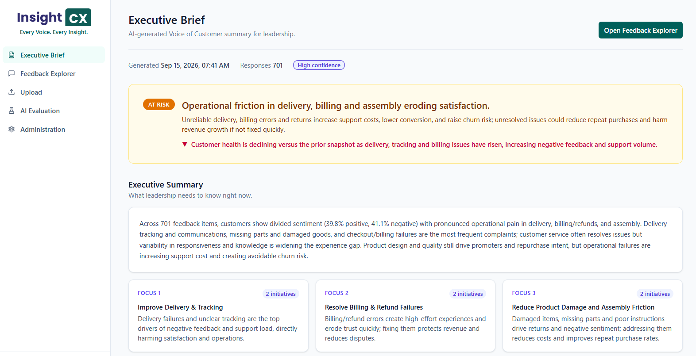
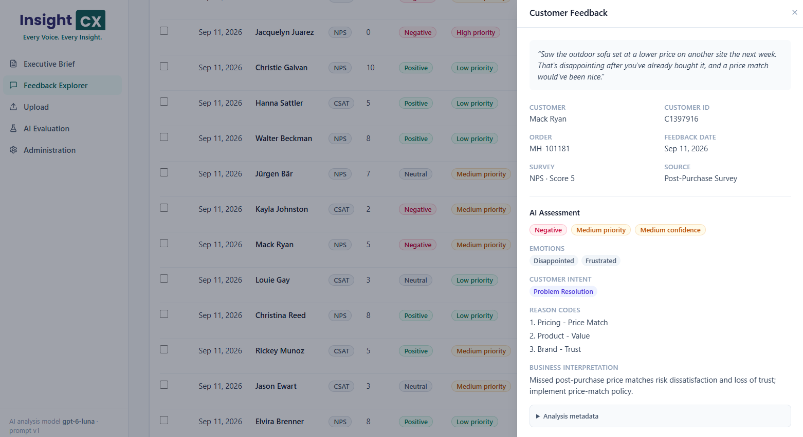
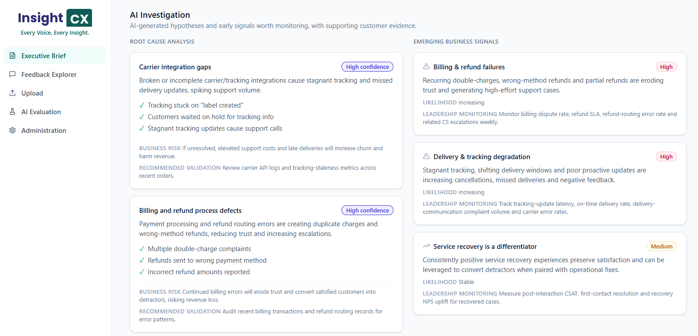
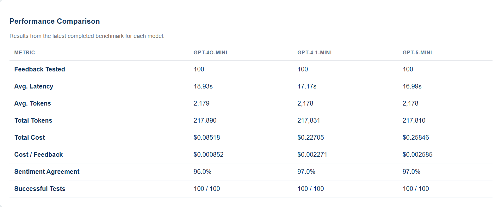

# InsightCX

**Every Voice. Every Insight.**

InsightCX is an AI-powered Voice of Customer (VoC) analytics platform designed to transform customer feedback into actionable business insights.

The application uses AI to analyse customer feedback, identify sentiment and emotional signals, highlight recurring themes, and generate executive summaries that help teams understand customer experiences and identify opportunities for improvement.

The project combines customer experience expertise with software engineering, AI, and automation to explore how unstructured feedback can support better business decisions.

<!-- SCREENSHOT 1: Executive Dashboard
Add your main dashboard screenshot here.
Suggested filename: assets/dashboard.png
Choose a view that highlights the main metrics, customer sentiment, and key feedback themes.
-->



## Features

* **Customer Feedback Analysis** – Analyse individual feedback entries using AI.
* **Sentiment & Emotion Detection** – Identify sentiment and emotional signals to better understand the customer experience.
* **Theme Identification** – Categorise feedback into relevant topics and recurring patterns.
* **Priority & Confidence Assessment** – Highlight potentially important feedback and provide confidence indicators for AI-generated classifications.
* **Executive Summaries** – Generate concise summaries of customer sentiment, key themes, business impact, and potential leadership priorities.
* **Feedback Import** – Upload customer feedback from CSV files for analysis.
* **AI Model Evaluation** – Compare model outputs using a benchmark dataset to explore consistency, latency, and cost.
* **Interactive Interface** – Explore feedback and insights through a web-based application.

## Application Preview

### AI-Powered Feedback Analysis



### AI-Generated Executive Summary



### AI Model Evaluation



## How It Works

InsightCX follows a simple workflow:

1. **Import feedback** from CSV files or use the available demo dataset.
2. **Analyse feedback** using AI to extract sentiment, emotions, themes, and other relevant signals.
3. **Explore insights** through the application interface to identify recurring patterns and potential issues.
4. **Generate executive summaries** that consolidate findings into an accessible overview for business stakeholders.
5. **Evaluate AI outputs** to explore model consistency, performance, and cost.

## Use Cases

InsightCX is being developed around customer experience and service feedback, with potential applications including:

* Identifying recurring customer pain points.
* Monitoring changes in customer sentiment and feedback themes.
* Highlighting potential service or process issues.
* Supporting data-informed customer experience improvements.
* Turning unstructured feedback into concise business insights.

The application currently uses a demo dataset to demonstrate its capabilities.

## Tech Stack

| Area              | Technologies                                       |
| ----------------- | -------------------------------------------------- |
| Backend           | Python, Flask                                      |
| Frontend          | React, Vite                                        |
| Database          | SQLite, Flask-SQLAlchemy                           |
| AI & LLMs         | OpenAI API, prompt engineering, structured outputs |
| Development Tools | Git, GitHub, PyCharm, VS Code                      |

## Getting Started

### Prerequisites

* Python 3.10 or newer
* Node.js and npm
* An OpenAI API key

### 1. Clone the repository

```bash
git clone <repository-url>
cd InsightCX
```

Replace `<repository-url>` with your repository URL.

### 2. Configure the backend

Create and activate a Python virtual environment:

```bash
python -m venv .venv
```

On Windows:

```powershell
.venv\Scripts\activate
```

Install the backend dependencies:

```bash
pip install -r requirements.txt
```

Create a `.env` file in the project root and add your OpenAI API key:

```env
OPENAI_API_KEY=your_openai_api_key
```

Keep your `.env` file out of version control. Never commit API keys or other secrets to GitHub.

### 3. Start the backend

From the project root, run:

```bash
python -m backend.app
```

### 4. Start the frontend

Open a second terminal and navigate to the frontend directory:

```bash
cd frontend
npm install
npm run dev
```

Open the local URL provided by Vite in your terminal.

*Note: These instructions assume the project uses the directory structure and dependency files shown above. Adjust them if your local configuration differs.*

## Project Status

InsightCX is an ongoing personal project exploring AI-powered customer feedback analytics.

The current implementation focuses on the core workflow: feedback analysis, insight generation, executive summaries, and basic AI model evaluation. The application is evolving, and its longer-term direction has not yet been finalised.

## Next Steps

Potential areas for further exploration include:

* Improving the analysis and presentation of customer insights.
* Exploring additional feedback sources or visualisations.
* Refining AI evaluation and output quality.
* Experimenting with workflow automation.

Future development will be guided by experimentation, practical use cases, and opportunities to improve the application.

## Purpose

InsightCX is a hands-on project exploring the intersection of **Customer Experience, data analytics, AI, and workflow automation**.

It brings together practical CX experience and software engineering skills to investigate how AI can transform customer feedback into meaningful business insights.
